<div align="center">

# Scaffld

### A robot teacher that finds the gaps in a robot's skills and builds its own lessons.

## One typed sentence → a new, tested robot skill in 39.7 minutes.

**No human demonstrations. No labels. The trained student then runs alone on a laptop.**

<sub>39.7 min is the wall-clock time of the measured stages (spec, demos, fine-tune, exam); it excludes a 70-minute wait for a busy GPU.</sub>

**AgentVerse 2026 (UCL) · Robotics Track**<br>
Unitree G1 humanoid in MuJoCo · **Argon** (gemini-4-argon) teaches from the cloud · a **SmolVLM2-500M** student runs on a laptop GPU

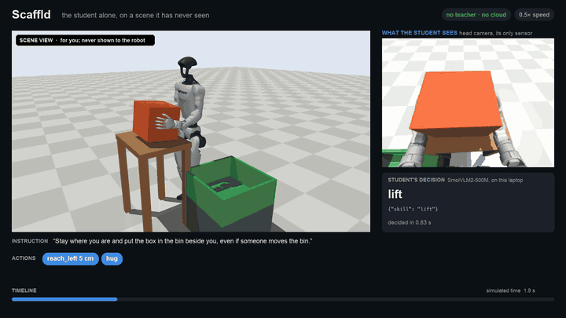

<sub>From our simulation video (<a href="docs/media/scaffld-simulation-video.mp4">full take, 54 s</a>). The student works alone on a scene it has never seen. After the lift, the simulator moves the bin without warning; the student, which sees only its head camera (right), still puts the box in. Shown at 0.5× speed.</sub>

<br>

| **39.7 min** | **0/20 → 18/20** | **10/20 → 18/20** (untargeted demos: also 18/20) | **19/20 vs 0/20** | **0** |
|:---:|:---:|:---:|:---:|:---:|
| to teach the robot **one new skill** from one sentence | unseen scenes the student then solves **alone** (17/20 with the bin moved) | after **one automatic teaching round** on a weaker student (p = 0.039) | the same student **with its camera vs a grey image** (on a Mac); a second student on the laptop GPU: 18/20 vs 0/20 | **teleoperated steps** or **human labels** |

[Technical summary (PDF)](docs/technical-summary.pdf) · [Pitch deck (PDF)](docs/deck/deck.pdf) · [How it works](#how-it-works) · [Repair loop](#the-repair-loop-test-diagnose-re-teach-until-its-good-enough) · [Results](#results) · [Impact](#impact) · [Videos](#videos) · [Live demo](#live-demo) · [Quickstart](#quickstart)

</div>

---

## The problem

Robots learn new skills from **human demonstrations**, and those are slow and costly: DROID needed 50 collectors for 12 months to record 76k trajectories, and RT-1 13 robots for 17 months for 130k episodes. Every new failure costs more operator hours.

**Scaffld hands that job to an agent.** In teaching, scaffolding is support given exactly where a learner struggles, then taken away. Here a cloud teacher, **Argon**, turns one sentence into a checked task, demonstrates it by driving the robot itself, keeps only what an independent validator accepts, and trains a small student that then **runs on the robot alone**.

## How it works

**Teaching one new skill takes 39.7 minutes**, measured stage by stage from the run's event logs (wall clock): the spec 24 s, 60 teacher demos 15.9 min (8 teachers in parallel), the fine-tune 21.2 min, the exam 2.3 min.

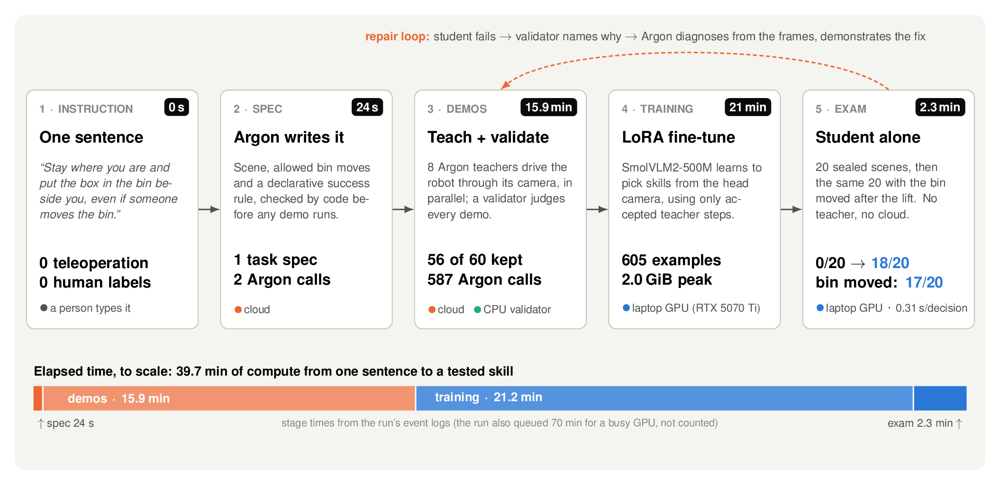

1. **One sentence.** A person types what the robot should learn. Nothing else is task-specific: no teleoperation, no labels.
2. **Argon writes the task.** The scene, which objects may move, and a **declarative success rule**, all checked by code before any demo runs.
3. **Argon teaches; a validator keeps what works.** Eight Argon teachers drive the robot in parallel through **the same head camera and skills the student will have**. An independent validator judges each demo from ground truth, and only accepted steps become training data.
4. **The student learns.** SmolVLM2-500M is fine-tuned with LoRA r16 on a laptop GPU to pick the next skill from the head-camera image.
5. **The student is examined alone** on 20 **sealed** scenes that no demonstration may use: no teacher, no cloud.

### The repair loop: test, diagnose, re-teach, until it's good enough

`mom run` keeps teaching a student until it is good enough, with no person in the loop. Typing into the dashboard's Teach box starts it.

1. **Type the task in words.** The dashboard's Teach box, or `mom run --instruction`.
2. **Test: see where the student is now.** The student alone on the 20 sealed scenes (round 0).
3. **Diagnose the mistakes.** The student tries 10 practice scenes. For each failure, Argon reads the saved frames, the skill calls and the validator's verdict, and says why it failed. One more call compares all ten trials, failed and successful, and groups the failures into up to 3 causes.
4. **Argon demonstrates on the weaknesses.** 20 demos: the failed scenes first, then fresh ones, each taught with the lesson for its cause. In 1 of 4 the bin moves right after the lift. The validator keeps only what works.
5. **Fine-tune** the student on every accepted demo so far.
6. **Test again** on the same 20 sealed scenes.
7. **Loop or stop.** Below 80% (16/20), it diagnoses the new student's mistakes and repeats steps 3 to 6, for up to 3 rounds. At 80% it stops by itself.

**Measured:** one round took the fixed-feet student v2 from **10/20 to 18/20**, past the target, so the loop stopped itself. An untargeted control matched it ([Results](#results)). The Teach box runs this loop for the task it serves; a brand-new task starts with the one-sentence path above.

### Architecture

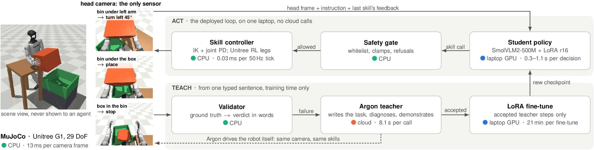

- **Camera in, skills out.** Agents see only a 320×240 head camera, the instruction and the last skill's feedback. Ground truth goes **only to the validator** (and to the orchestrator, which makes the scene changes), never to an agent.
- **10 whitelisted skills** (reach, hug, lift, turn, walk, place, reobserve...), executed by IK and joint PD control. Walking uses Unitree's pretrained RL policy.
- **Safety gate.** Every skill call is checked, clamped or refused before anything moves.

| Model (role) | Runs on | Latency (n); memory |
|---|---|---|
| SmolVLM2-500M + LoRA (**student**) | laptop GPU (RTX 5070 Ti), bf16 | **0.31 s** median, 0.56 s p95 (showcase exam, n = 326); 1.08 s median (v2's 35-minute exam, n = 237); peak 2.01 GiB (v1/v2 exam) |
| LoRA r16 fine-tune (**training**) | laptop GPU | 21 min for 605 examples; peak 2.0 GiB (showcase) |
| Argon, gemini-4-argon (**teacher**) | cloud, teaching only | 8.1 s median, 19.5 s p95 (every teacher call, n = 3,551) |
| Unitree RL walking policy (**legs**) | CPU, NumPy | 0.03 ms per 50 Hz tick (bench, n = 2,000) |
| MuJoCo 4.0 + validator (**world**) | CPU (Apple M5) | 13 ms per camera frame (bench, n = 50) |

Every number's run and count: [Where the numbers come from](#where-the-numbers-come-from).

## Results

Every result is the **student alone** on sealed held-out scenes, against a control that changes **one thing**, with n stated.

**The one-sentence student** (`tasks.learn`, task `box_to_bin_fixed`, 56 accepted demos):

| Claim | Result | Control (same seeds) | Source |
|---|---|---|---|
| **One sentence → a new skill** | **18/20** | untrained model: 0/20 | [PR #34](https://github.com/owenbonc/scaffld/pull/34#issuecomment-6718403706) |
| ...with the **bin moved after the lift** | **17/20** | untrained model: 0/20 | the showcase run's `report.json`, [PR #34](https://github.com/owenbonc/scaffld/pull/34#issuecomment-6718403706) |
| **The student acts on what it sees** (on a Mac) | **19/20** with its camera | 0/20 with a grey image | [PR #22](https://github.com/owenbonc/scaffld/pull/22#issuecomment-6719281987) |
| **Demos teach the decision to stop** | 56 demos: **18/20** | 14 or 28 demos: 0/20 | [PR #22](https://github.com/owenbonc/scaffld/pull/22#issuecomment-6719281987) |
| **Accepted demos replay exactly** (on the machine that recorded them) | **56/56** | — | [PR #34](https://github.com/owenbonc/scaffld/pull/34#issuecomment-6718403706) |

**Recovery lessons on the fixed-feet student** (v1, 52 demos → v2, 117 demos with recovery and box-moved demos):

| Claim | v2 | v1 (same seeds) | Source |
|---|---|---|---|
| **Box moved at the start** | **15/20** | 7/20 (an earlier, separate run) | [PR #22](https://github.com/owenbonc/scaffld/pull/22#issuecomment-6717726778) |
| **Bin placements never seen in training** | **21/40** | 14/40; exact McNemar p = 0.19 overall. Bin further ahead: 4/20 → **14/20**, p = 0.006; further away: 10/20 → 7/20 | [PR #22](https://github.com/owenbonc/scaffld/pull/22#issuecomment-6718403477) |

**One automatic teaching round** (`mom run --from-run`, on the fixed-feet student v2, 117 demos):

| Claim | Result | Control (same seeds) | Source |
|---|---|---|---|
| **One round lifts the student** | round 1: **18/20** | round 0, v2 re-examined in the same run: 10/20. 10 seeds fail → pass, 2 pass → fail; exact McNemar p = 0.039 | [PR #22](https://github.com/owenbonc/scaffld/pull/22#issuecomment-6721136914) |
| **It acts on what it sees** (laptop GPU) | **18/20** with its camera | 0/20 with a grey image | [PR #22](https://github.com/owenbonc/scaffld/pull/22#issuecomment-6721243829) |
| **What the gain comes from** | 17 diagnosed, targeted demos: 18/20 | 17 untargeted demos, no diagnosis: **18/20**; the two differ on no seed | [PR #22](https://github.com/owenbonc/scaffld/pull/22#issuecomment-6721840949) |

- **The round's gain comes from its 17 new accepted demos and the retraining; targeting added nothing measurable over the same number of untargeted demos** (both 18/20; n = 20, possible ceiling). With its camera the round-1 student stops at 90° on 17/20 seeds and never over-twists (v2 over-twisted on 6); given a grey image it twists once and misses on all 20.
- **18/20 and 17/20 against 0/20:** every success is a seed the untrained model failed, so the exact McNemar p is 2 × 0.5¹⁸ = 7.6 × 10⁻⁶ and 2 × 0.5¹⁷ = 1.5 × 10⁻⁵. A re-run reproduced every seed's outcome.
- **Its decision to stop comes from the image.** With its camera the student ends 90° round (two 45° twists) on all 20 seeds; given a grey image it twists once on all 20 and misses ([per-seed log](docs/pitch/data/sources/vision-control-showcase-mac.log)). With 14 or 28 demos it never learns when to stop; with 56 it does.

<p>
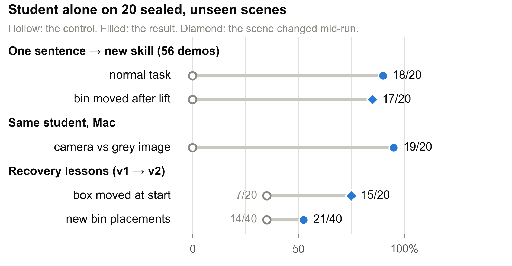
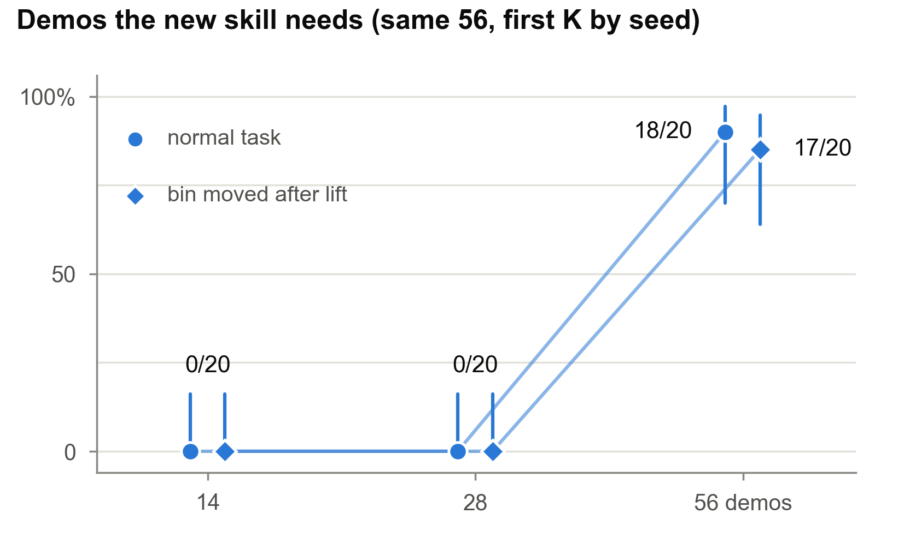
</p>

<p>
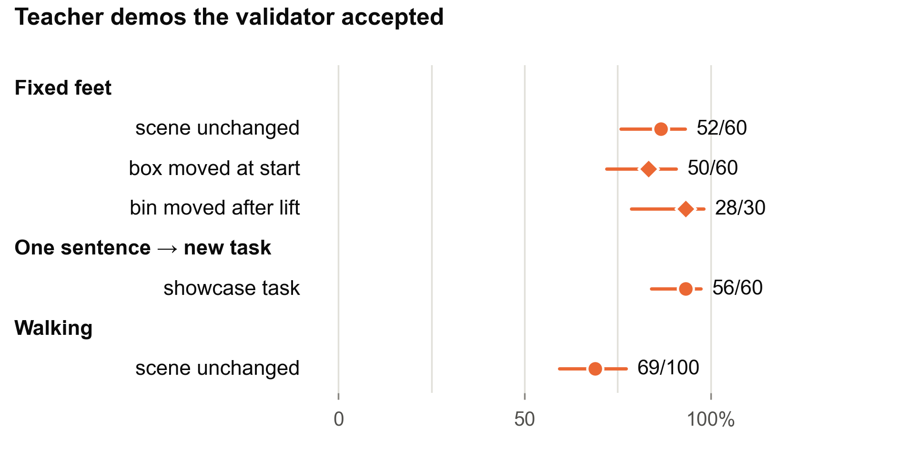
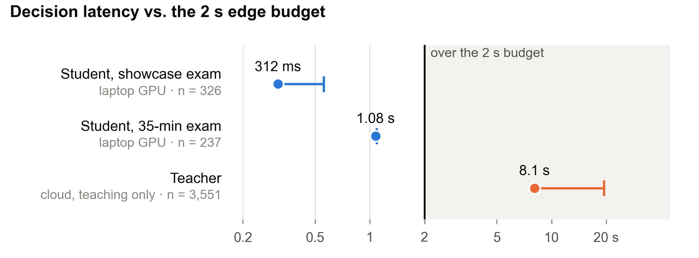
</p>

- **The teacher completes demos at scale:** the validator accepted 56/60 for the one-sentence task, 52/60 for fixed feet, and 69/100 for walking. The submitted loop uses `fixed_feet`.
- **Inside the edge budget (≤ 2 s, ≤ 3 GB):** 0.31 s median per decision in the showcase exam (n = 326, 1 over 2 s). In v2's 35-minute exam the median was 1.08 s (n = 237); 2 of that exam's 2,145 decisions, across both students and three conditions, passed 2 s, both the first after loading.

## Impact

**Measured on the one-sentence showcase run.** Sources are [at the end](#where-the-numbers-come-from).

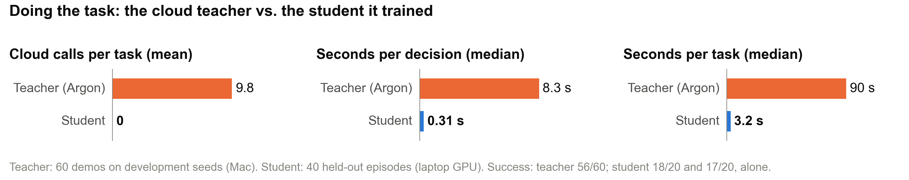

| | **Scaffld (measured)** | **Baseline** |
|---|---|---|
| **Human involvement** | **1 typed sentence.** 0 teleoperated steps (of 584 demo steps), 0 human labels (100 verdicts judged by code) | Teleoperated collection: DROID used 50 collectors for 12 months (76k trajectories, 350 h) |
| **Teacher calls** | **589 for the whole skill** (10.5 per accepted demo); **0 at deployment** | The teacher running the robot itself: **9.8 cloud calls per task** (mean, n = 60) |
| **Training cost** | **20.9 GPU-minutes** on one laptop RTX 5070 Ti; 2.0 GiB peak; 605 examples | — |
| **Time to a tested skill** | **39.7 min** (wall clock: spec 24 s, demos 15.9 min, fine-tune 21.2 min, exam 2.3 min) | — |
| **Success** | **18/20** alone on sealed scenes; **17/20** with the bin moved | untrained student: 0/20 and 0/20 |
| **Speed at deployment** | **0.31 s per decision, 3.2 s per task** (showcase exam, n = 326 decisions, 40 tasks), no cloud | teacher: 8.3 s per decision, 90 s per task (showcase demos, n = 60) |

<sub>Teacher and student ran on different seeds and machines by design: the held-out seeds are sealed from the teacher. Argon's token usage is not logged, so cost is given in calls.</sub>

## Videos

### The whole loop in one minute

<a href="docs/media/scaffld-full-loop.mp4">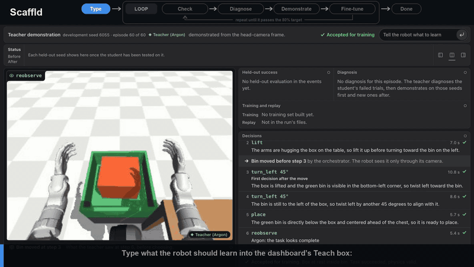</a>

<sub><b><a href="docs/media/scaffld-full-loop.mp4">Watch the full video (58 s, MP4)</a>.</b> It starts in the dashboard: the sentence is typed into Teach, the loop's first frame appears in the stage, and the stage fills the screen. Then the loop runs round by round under a top bar (Check → Diagnose → Demonstrate → Fine-tune, repeat until the 80% target):</sub>

1. **Check:** the untrained student is stuck (0/20).
2. **Diagnose:** Argon names the failure from the trials ("stuck calling reach_left past its 12 cm limit instead of hugging").
3. **Demonstrate:** Argon shows the task through the same camera, and the validator keeps only what works.
4. **Fine-tune.**
5. **Check:** the student does it alone (10/20). Argon diagnoses its over-twist and demonstrates turning back and placing.
6. **Fine-tune again, then check:** **10/20 → 18/20** per seed (p = 0.039). That meets the target, so the loop stops.

**The video joins two runs.** Steps 1–5 (0/20 → 10/20) are the untrained student and the fixed-feet student v2, trained on 117 demos in a separate run ([PR #22 6718403477](https://github.com/owenbonc/scaffld/pull/22#issuecomment-6718403477)), not one loop round. Step 6 is one real loop round, `gate-e-1008` ([6721136914](https://github.com/owenbonc/scaffld/pull/22#issuecomment-6721136914)). An untargeted control with the same number of new demos also reached 18/20, so targeting added nothing measurable over the same number of untargeted demos (both 18/20; n = 20, possible ceiling; [6721840949](https://github.com/owenbonc/scaffld/pull/22#issuecomment-6721840949)); the video says so on its last card. Footage: students filmed on unseen video seeds, and Argon's demos re-executed from their records; numbers from the round reports ([sources](#where-the-numbers-come-from)).

<table>
<tr>
<td width="33%"><a href="docs/media/scaffld-story-take.mp4">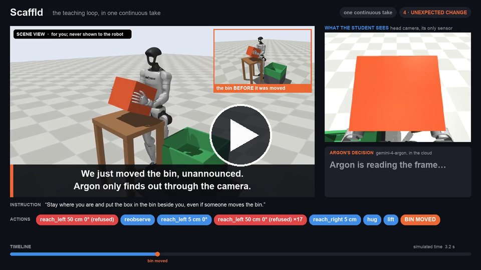</a><br><sub><b>One continuous take (48 s).</b> The untrained student fails, Argon takes over from the same camera, the bin is moved unannounced and Argon re-aims; the validator accepts and the saved trajectory replays to the same verdict. Argon's thinking time is shown faster (labelled).</sub></td>
<td width="33%"><a href="docs/media/before-after-one-seed.mp4">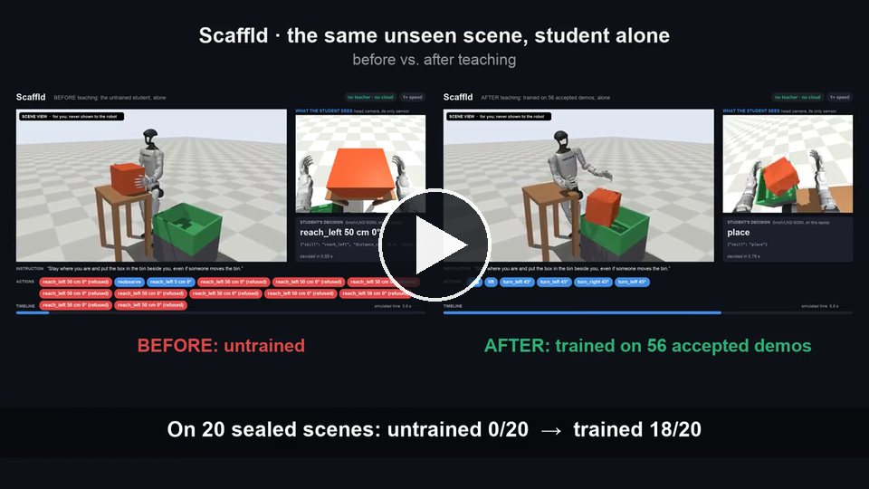</a><br><sub><b>Before and after, same scene (28 s).</b> The untrained student is stuck making refused moves; the student trained on 56 demos places the box alone (0/20 → 18/20 on sealed scenes).</sub></td>
<td width="33%"><a href="docs/media/walking-full-screen.mp4">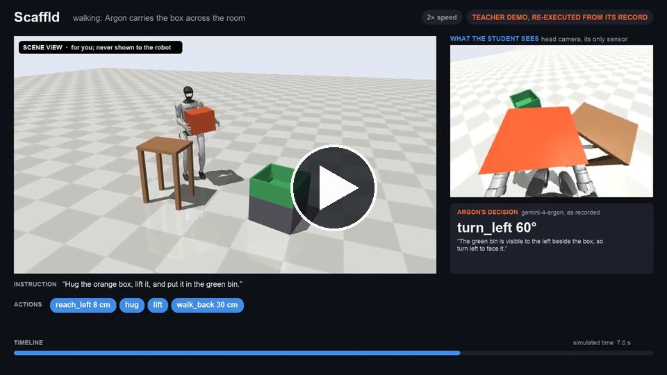</a><br><sub><b>The teacher walks (24 s).</b> Argon carries the box across the room and places it, with its reasons; an accepted demo re-executed from its record at 2× speed (69/100 walking demos accepted).</sub></td>
</tr>
</table>

### More clips

**The simulation video:** [`scaffld-simulation-video.mp4`](docs/media/scaffld-simulation-video.mp4) (54 s, one continuous take filmed from the simulator; excerpt at the top of this page). The student works alone, the bin is moved after the lift, and the screen shows what the student sees, each decision with its timing, a snapshot of the bin before it moved, and the validator's verdict.

**Six unseen scenes, six bin moves, one student, no help.** On each scene the simulator moves the bin right after the lift, by 14°–20° and 12–17 cm, and the student still delivers. In a run of 30 such scenes it delivered 25, and in one of the 5 misses the bin never moved ([scan log](docs/pitch/data/sources/sim-video-scan.log)); the held-out rate is 17/20. Shown at 1.5× speed.

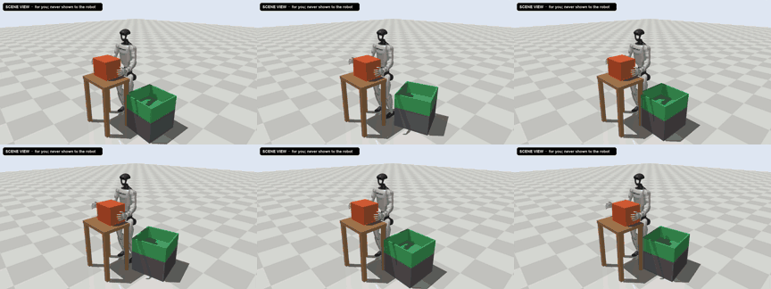

<table>
<tr>
<td width="50%">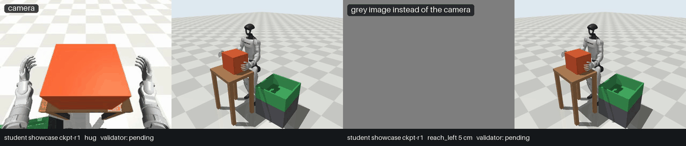<br><sub><b>It acts on what it sees.</b> Same scene, same student: with its camera it twists until the bin is under the box; with a grey image it twists once and misses (19/20 vs 0/20, on a Mac).</sub></td>
<td width="50%">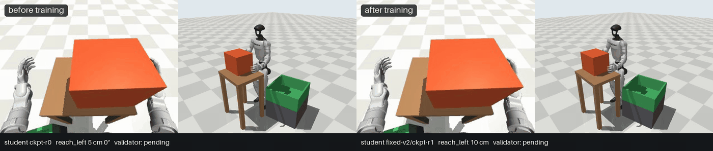<br><sub><b>Before and after teaching.</b> Before, the model repeats <code>reach_left</code> until the teacher takes over at step 20; after, the student does it alone in 8 steps (fixed-feet student v2).</sub></td>
</tr>
<tr>
<td width="50%">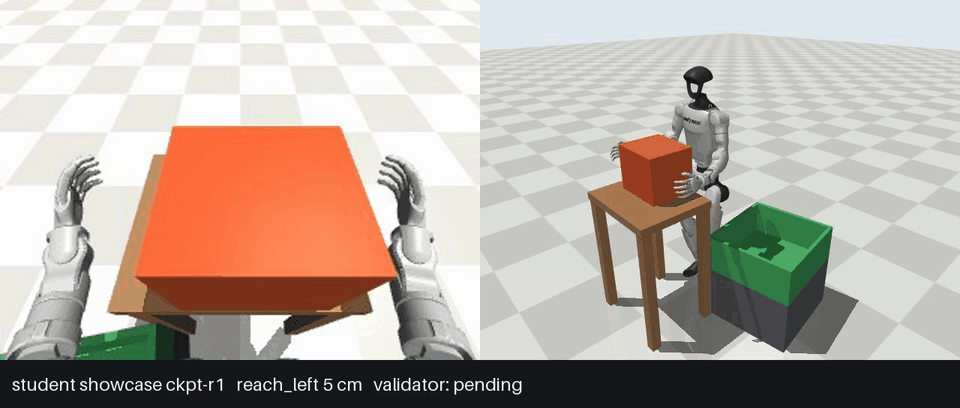<br><sub><b>The bin moves after the lift</b>; the student, alone, still puts the box in (17/20 on sealed scenes, within the range it trained on).</sub></td>
<td width="50%">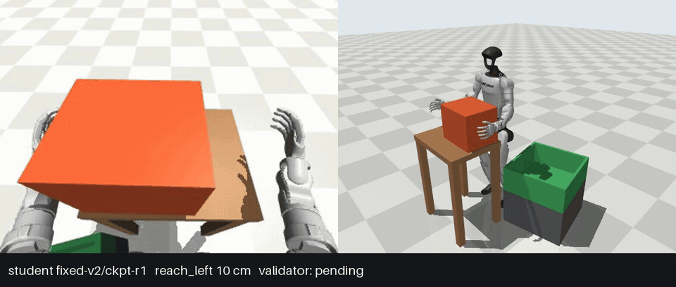<br><sub><b>The box is moved before the student starts;</b> it still delivers alone (box moved at the start: 15/20 held-out, fixed-feet student v2).</sub></td>
</tr>
<tr>
<td width="50%">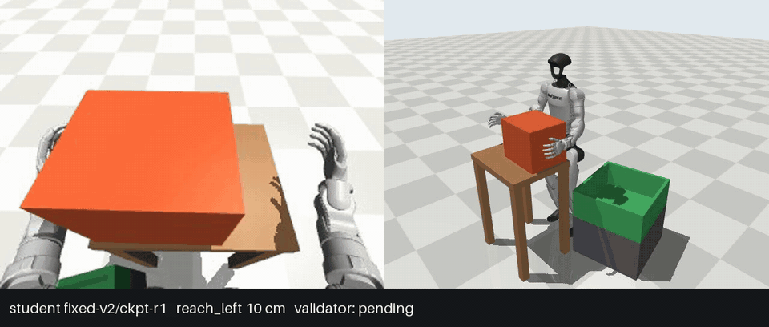<br><sub><b>The trained student, alone,</b> on an unseen scene: reach, hug, lift, two 45° twists, place.</sub></td>
<td width="50%">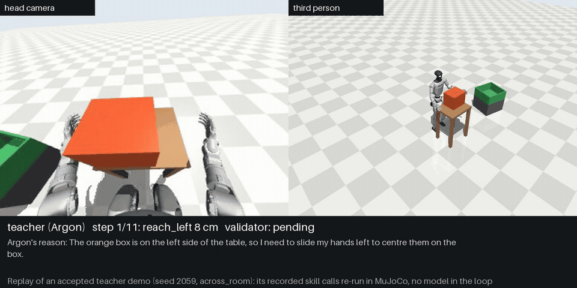<br><sub><b>The teacher walks.</b> Argon carries the box about a metre and places it, with its logged reasons; a replay of an accepted demo (69/100 walking demos accepted).</sub></td>
</tr>
<tr>
<td colspan="2"><p align="center">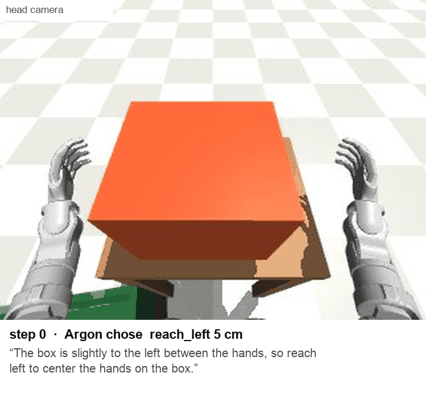</p><sub><b>What the teacher sees and why it acts.</b> Argon's head-camera view in an accepted demo, with the reason it logged for each skill; the bin is moved right after the lift.</sub></td>
</tr>
</table>

## Live demo

**Repeatable, student alone, no teacher, no cloud.** It plays in a window while it runs, and saves an MP4:

```sh
cd docs/live-demo
./run.sh grey     # the same scene twice: with its camera, then with a grey image instead
./run.sh live     # the student alone, the bin moved after the lift, with opening and closing cards
```

- **What it shows:** the student changes its action because of what it sees. With its camera it delivers; given a grey image, the same student on the same scene twists once and misses.
- **Repeatable:** each demo scene was re-run 2 to 6 times in separate processes and gave identical steps every time.
- **How the takes are made:** `docs/live-demo/sim_video2.py` runs the showcase student with the spec's own bin move after the lift. It needs the showcase checkpoint copied to `docs/live-demo/runs/` (gitignored); see [`docs/live-demo/README.md`](docs/live-demo/README.md). The repo's own judged-take command, `mom demo`, moves the **box** instead and can hand over to the teacher.
- **Walking:** the teacher completes walking demos (69/100 accepted); the walking student has its first successes, **2/20** sealed scenes against 0/20 untrained ([PR #22](https://github.com/owenbonc/scaffld/pull/22#issuecomment-6716999200)).

## Safety and limits

- **Failure mode: acting on a stale picture of the world.** If the box or bin moves mid-task, a robot replaying its plan grasps air or drops the box. **Our agents keep no plan:** every skill is chosen from the newest camera frame, and recovery lessons more than doubled success with the box moved.
- **When unsure, look again.** An unparseable answer becomes `reobserve`; two in a row end the episode.
- **Safe motion.** Only whitelisted, clamped skills run. A move past a limit (e.g. a fourth 45° twist), an unreachable target or a walk into the table is **refused before anything moves**. The validator rejects falls, joint-limit violations and penetration, so **unsafe demos never train**.
- **Data and secrets.** Sealed held-out seeds, an 800-call Argon cap per run, keys never logged; 600+ tests pin these rules.
- **Limits.** Simulation only; sim-to-real is next. One task family, learned at the skill level. The student follows a learned routine and does not yet re-aim when the bin moves beyond its training range (moved to 125°: 1/20, on a Mac); the teacher does. Teaching needs the cloud; the deployed student does not.

## Quickstart

**Requirements:** Python 3.12 and [uv](https://docs.astral.sh/uv/). macOS on Apple Silicon runs the simulator, the student, `mom eval`, `mom demo` and the dashboard. **Fine-tuning needs Windows with an NVIDIA GPU** (CUDA 12.8 wheels; we use an RTX 5070 Ti laptop). Linux gets CPU-only PyTorch: the sim and tests run, fine-tuning does not.

```sh
git clone https://github.com/owenbonc/scaffld.git
cd scaffld
uv sync --frozen
cp .env.example .env          # then set GEMINI_API_KEY=<your Gemini API key>
```

`.env` is gitignored, and keys show as `[key]` in errors and events. `ARGON_CALL_BUDGET` caps Argon calls per run (800 by default). `mom eval`, the stub teacher and the tests never call Argon.

**Smoke run: no key, no GPU.**

```sh
uv run mom run --sim fake --student stub --rounds 1 --run-id smoke
uv run mom dashboard --runs runs        # http://127.0.0.1:8200
```

**See the real scene** (no key, no GPU):

```sh
mkdir -p runs
uv run python -m isaacs_mom.sim.mujoco.preview --task fixed_feet --seed 3 --gif runs/seed3.gif
```

## Commands

Pass `--task fixed_feet` everywhere on MuJoCo: the CLI default is the walking task (`across_room`), and the fake sim plays only `across_room`.

| Command | What it does |
|---|---|
| `uv run python -m isaacs_mom.tasks.learn "<sentence>"` | **One sentence → a new skill:** writes the spec, collects parallel Argon demos, fine-tunes, examines the student alone |
| `uv run mom run --task fixed_feet` | The repair loop: evaluate, diagnose failures, demonstrate, fine-tune, repeat |
| `uv run mom eval --task fixed_feet --ckpt <run_id>/ckpt-r1` | The evaluation report: student alone on sealed seeds, three conditions, latency against the budget |
| `uv run mom demo --task fixed_feet --ckpt <run_id>/ckpt-r1 --seed 900001 --perturb-at 2` | The judged single take: the box is moved before step 2, recorded to MP4 |
| `uv run mom dashboard --runs runs --task fixed_feet` | Live dashboard with Teach, at http://127.0.0.1:8200 |
| `scripts/verify.sh` | Lint, types, tests and secret scan; prints READY or NOT READY |

<details>
<summary><b>tasks.learn</b>: flags</summary>

```sh
uv run python -m isaacs_mom.tasks.learn "Deliver the box to the bin, even if someone moves the bin." --demos 40 --workers 8
```

| Flag | Default | Meaning |
|---|---|---|
| `"<instruction>"` | none | what to learn (or `--resume` instead) |
| `--demos N` | `40` | demonstrations to collect |
| `--workers K` | `8` | parallel teacher processes |
| `--move-bin-share X` | `0.5` | share of demos where the bin moves after the lift, if the spec lets it move |
| `--exam-seeds N` | `20` | held-out seeds in the exam |
| `--with-base` | off | also examine the base model on the same seeds |
| `--collect-only` | off | stop after collecting; no GPU needed |
| `--resume runs/<run_id>` | none | fine-tune and examine a finished batch |

A new instruction needs the key; fine-tuning needs CUDA. To collect on one machine and train on another, copy the run directory into the GPU machine's `./runs` and `--resume` there. The report goes to `runs/learn-<spec>-<fingerprint>-<date>-<time>/report.json`.
</details>

<details>
<summary><b>mom run</b>: flags</summary>

| Flag | Default | Meaning |
|---|---|---|
| `--task` | `across_room` | task preset (`fixed_feet` for the loop) |
| `--sim {mujoco,fake}` | `mujoco` | the MuJoCo G1 scene, or FakeSim |
| `--student {smolvlm,stub}` | `smolvlm` | SmolVLM2-500M, or random skills with no training |
| `--teacher {argon,stub}` | `argon` (`stub` on fake) | Argon, or an offline stand-in |
| `--rounds N` | `3` | fine-tune rounds; `0` only evaluates |
| `--demos N` | `20` | teacher demonstrations per round |
| `--dev-trials N` | `10` | student trials per round for the teacher to diagnose |
| `--instruction TEXT` | `Hug the orange box, lift it, and put it in the green bin.` | what the robot learns |
| `--from-run runs/<run_id>` | none | start from an earlier run's checkpoint and accepted demos |
| `--move-bin-share X` | `0.25` | share of demos where the bin moves after the lift |
| `--run-id ID` / `--runs DIR` | `run-<date>-<time>` / `runs` | where the run is written |

The real student fine-tunes on CUDA, so `--student smolvlm` with `--rounds` above 0 needs it.
</details>

<details>
<summary><b>mom eval</b> and <b>mom demo</b>: flags</summary>

`mom eval` runs the base checkpoint and each `--ckpt` on the sealed seeds, student alone, in three conditions: `training_distribution`, `new_layout` (two bin layouts the task never uses) and `move_bin_after_lift`. It reports successes out of (n − errored), adaptations out of applied moves, and median and p95 latency against the budget. Flags: `--ckpt ID` (repeatable), `--task`, `--student {smolvlm,stub}`, `--seeds N`, `--budget-ms MS` (2000).

`mom demo` runs the student on a scene no episode has seen, moves the box before a chosen step, and records head camera and third-person view side by side to an MP4 at 2 fps. If the student stops without success, the teacher takes over. Flags:

| Flag | Default | Meaning |
|---|---|---|
| `--ckpt ID` | required | `ckpt-r0` or `<run_id>/ckpt-r<round>` |
| `--seed S` | required | an unseen scene, 900000 or above |
| `--perturb-at N` | required | move the box before step N |
| `--out PATH` | `demo.mp4` | the video |
| `--run-id ID` | `demo-<date>-<time>` | a fresh run directory |
| `--task`, `--sim`, `--student`, `--teacher`, `--runs` | as for `mom run` | `--teacher stub` needs no key |
</details>

<details>
<summary><b>Dashboard</b>: keys and remote use</summary>

The page follows each run's `events.jsonl` live: a run picker, a **Results** tab (held-out seeds before and after fine-tuning) and a **Teaching** tab (trials, diagnoses, demos, fine-tune). Keys: Space pause, ← → move, D diagnosis, T teacher demo, M the move, End back to live. **Teach:** type what the robot should learn; an instruction for the box-in-bin task starts `mom run` on the serving machine. The server answers only on 127.0.0.1; tunnel the same port to watch remotely: `ssh -L 8200:127.0.0.1:8200 <gpu-host>`.
</details>

## Repository layout

```
isaacs_mom/
  contracts.py      shared types: skills, observations, manifests, events
  seeds.py          the sealed held-out seeds; teacher and training sets refuse them
  sim/              FakeSim and the MuJoCo G1 scene: head camera, arm IK, skills,
                    task presets, Unitree's walking policy
  teacher/          Argon: diagnoses failures from frames and demonstrates, behind a call budget
  validator/        verdicts from ground truth, the episode recorder, training sets, replay
  student/          SmolVLM2 student: prompt, parser, done rule, LoRA fine-tuning
  orchestrator/     the `mom` CLI, the loop, `mom eval`, `mom demo`, the dashboard
  tasks/            task generator (sentence → checked spec) and tasks.learn
configs/            the sealed held-out seeds
scripts/            verify.sh, merge-gate.mjs, agent setup
tests/              the offline pytest suite (600+ tests)
docs/
  technical-summary.pdf    the one-page technical summary; its LaTeX and figure scripts in technical-summary/
  deck/                    the pitch deck (PDF and LaTeX)
  pitch/                   the pitch kit: slide numbers, captions, measured data and the raw logs behind them
  live-demo/               the live-demo and video scripts
  media/                   the images and clips on this page
```

## Team

- **Owen Yan** ([@owenbonc](https://github.com/owenbonc)): the spec and the foundation; the orchestrator, `mom demo` and the dashboard with Teach (WS5).
- **Isaac** ([@ish24cho](https://github.com/ish24cho)): the MuJoCo G1 scene, hugging, walking and fixed-feet tasks (WS1); the task generator, `mom eval`, `tasks.learn`, the evaluation and the experiments.
- **Santi** ([@santiagoalvarezv](https://github.com/santiagoalvarezv)): the Argon teacher, its call budget and stub (WS2).
- **Anh** ([@Infergnog69](https://github.com/Infergnog69)): the validator, recorder, training sets and replay (WS3).
- **Josh Lim** ([@Josh-Lim18](https://github.com/Josh-Lim18)): the SmolVLM2 student and LoRA fine-tuning on the local GPU (WS4).

## Key documents

- [`SPEC.md`](SPEC.md): purpose, the non-negotiable rules, each part of the system, contracts and acceptance criteria.
- [`PRODUCT.md`](PRODUCT.md): who the dashboard is for and its principles (evidence over decoration; an n on every number).
- [`AGENTS.md`](AGENTS.md): conventions for teammates and coding agents.
- [`docs/workstreams.md`](docs/workstreams.md): what each of the five workstreams builds.
- [`docs/technical-summary.pdf`](docs/technical-summary.pdf) and [`docs/deck/deck.pdf`](docs/deck/deck.pdf): the one-page summary and the pitch deck.
- [`docs/pitch/README.md`](docs/pitch/README.md): the pitch kit, with every number's source.

## Where the numbers come from

<details>
<summary><b>Every number on this page: its run, what was counted, and n</b></summary>

- **Student results.** [PR #34 comment 6718403706](https://github.com/owenbonc/scaffld/pull/34#issuecomment-6718403706): showcase run `learn-box_to_bin_fixed-57288f663c83-040045`, the exam's `report.json` (18/20; bin moved 17/20, move applied 20/20) and the untrained baseline from `showcase-compare`. [PR #22 6719281987](https://github.com/owenbonc/scaffld/pull/22#issuecomment-6719281987): the learning curve and the camera vs grey-image control. [6718403477](https://github.com/owenbonc/scaffld/pull/22#issuecomment-6718403477): v1 vs v2 (`runs/eval-v1v2-20261108-055547`). [6717726778](https://github.com/owenbonc/scaffld/pull/22#issuecomment-6717726778): box moved at the start. [6716999200](https://github.com/owenbonc/scaffld/pull/22#issuecomment-6716999200): the walking student, 2/20.
- **Stage times (39.7 min).** The showcase run's event logs: spec 23.5 s (`learn-generator` events), demos 952.7 s (first `episode_started` to last `validation` across 8 workers), fine-tune 1,271.7 s (resume launch to the first exam event; 1,255.3 s of training in `checkpoints/ckpt-r1/metrics.json`), exam 135.9 s. Sum 2,383.8 s. [`docs/pitch/data/workflow_timeline.csv`](docs/pitch/data/workflow_timeline.csv).
- **Showcase exam latency (0.31 s median, 0.56 s p95, n = 326, 1 over 2 s, 0 Argon calls).** `decision` events with `latency_ms` in the exam's two event logs ([`docs/pitch/data/sources/`](docs/pitch/data/sources/)).
- **35-minute exam (1.08 s, n = 237; 2 of 2,145 over 2 s).** `runs/eval-v1v2-20261108-055547` on the RTX 5070 Ti: `decision` events per student and condition (v2 training task n = 237; all six rows 237 + 461 + 245 + 287 + 637 + 278 = 2,145); peak 2.01 GiB from that exam.
- **Fine-tune memory (2.0 GiB).** `checkpoints/ckpt-r1/metrics.json`, `peak_gpu_memory_gb`, of the showcase run.
- **Argon latency (8.1 s median, 19.5 s p95, n = 3,551).** Every `argon_call` event with purpose `act` and `ok = true` in `walking-trial/*/events.jsonl` (29 files) and the two `learn-*` batches' worker logs (14 files): 3,579 calls, 28 failed. Script and output: [`docs/pitch/data/evidence/`](docs/pitch/data/evidence/).
- **Walking policy (0.03 ms per tick, n = 2,000) and MuJoCo (13 ms per camera frame, n = 50).** `bench_sim.py` on an Apple M5; output in [`docs/pitch/data/evidence/sim-and-walking-bench.txt`](docs/pitch/data/evidence/sim-and-walking-bench.txt).
- **Teacher acceptance.** 56/60: the showcase manifests (bin moved 28/30). 52/60: [PR #22 comment](https://github.com/owenbonc/scaffld/pull/22) at 02:55 (10 parallel teachers, seeds 3000–3059). 69/100: `walking-trial/batch-walk-0203/c*/results.json` (10 parallel teachers, seeds 2000–2099).
- **Teacher at deployment (9.8 calls, 8.3 s per decision, 90 s per task).** The showcase demos' worker logs: `argon_call` per episode (mean 9.78, median 8, n = 60), `decision.latency_ms` (median 8.29 s, n = 584), `episode_started` to `validation` (median 89.6 s, n = 60).
- **Human involvement.** Every executed demo step has `controller = teacher` (584 steps) and every exam decision `controller = student` (326); all 60 demo and 40 exam verdicts come from the spec's rule in code.
- **Bin moved to 125° (1/20) and the 30-scene scan (25/30; in one miss the bin never moved).** Mac float32 runs of the showcase student: [`docs/pitch/data/sources/`](docs/pitch/data/sources/).
- **One teaching round.** On the RTX 5070 Ti, code at phase-1 `03321aa`, both runs started by `mom run --task fixed_feet --from-run runs/fixed-v2 --rounds 1`:
  - `runs/gate-e-1008`: `evaluation_result` round 0 (10/20) and round 1 (18/20); 20 teacher demos, 17 accepted, 1,212 training examples. This round ran before the round-level comparison in step 3 of the repair loop merged (#37), so it diagnosed each failure on its own; the comparison was checked once on real Argon on this round's 10 trials ([PR #22](https://github.com/owenbonc/scaffld/pull/22#issuecomment-6721243829)).
  - `runs/gate-e-control-1130`: the same command run through [`control_untargeted.py`](docs/pitch/data/evidence/control_untargeted.py), which removes the diagnosis and the targeting (fresh dev seeds 1520–1539, no lesson); round 0 10/20, round 1 18/20, 17/20 demos accepted.
  - The grey-image control on `gate-e-1008/ckpt-r1`, run by [`blind_vs_sighted.py`](docs/pitch/data/evidence/blind_vs_sighted.py) (the script behind the Mac controls too): 18/20 vs 0/20 over held-out seeds 1–20, per seed in [`docs/pitch/data/sources/vision-control-gate-e-5070.log`](docs/pitch/data/sources/vision-control-gate-e-5070.log).
  - Per-seed outcomes: [PR #22 6721136914](https://github.com/owenbonc/scaffld/pull/22#issuecomment-6721136914), [6721243829](https://github.com/owenbonc/scaffld/pull/22#issuecomment-6721243829) and [6721840949](https://github.com/owenbonc/scaffld/pull/22#issuecomment-6721840949).
- **DROID.** Khazatsky et al., arXiv:2403.12945 (v2): "76k demonstration trajectories or 350 hours of interaction data ... by 50 data collectors ... over the course of 12 months". A reference point, not a matched baseline.
</details>
